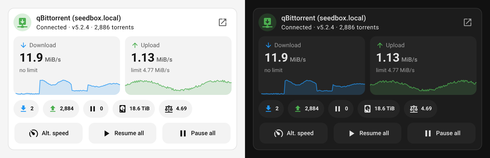
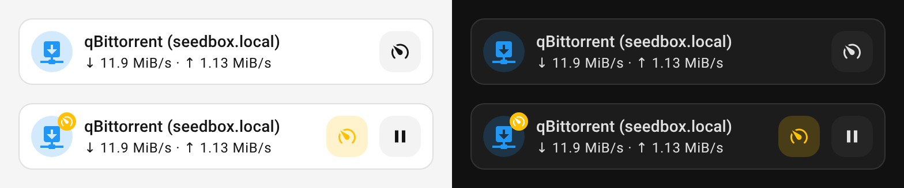
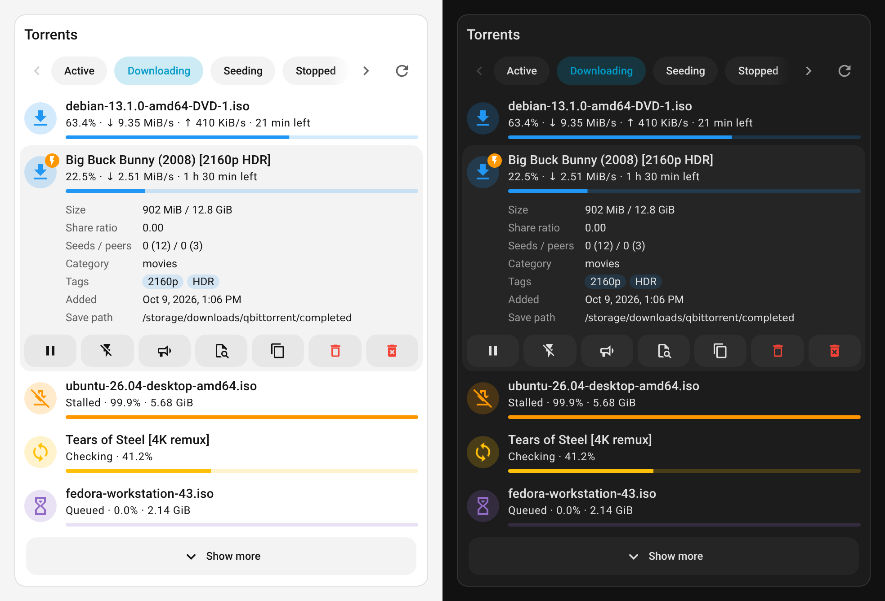
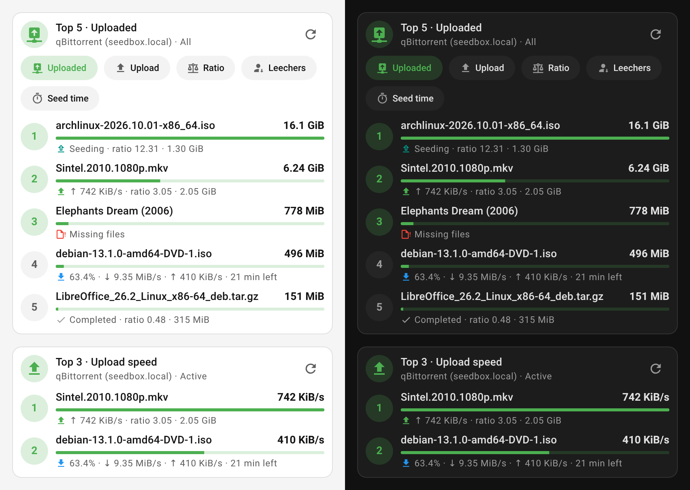

# qBittorrent (Advanced) Cards

[](https://hacs.xyz/docs/faq/custom_repositories)
[](https://github.com/KifKick/qbittorrent-hass-cards/releases)
[](https://github.com/KifKick/qbittorrent-hass-cards/actions/workflows/ci.yml)

Dashboard cards for the [qBittorrent (Advanced)](https://github.com/KifKick/qbittorrent-hass) Home Assistant integration: an overview of your qBittorrent client and a live torrent list you can act on. One HACS entry, one JavaScript file, three cards, in the style of [Mushroom](https://github.com/piitaya/lovelace-mushroom).



## Features

- **Overview card**: connection status, download/upload speed with the current limit and a speed history graph, torrent counts, free space, share ratio, and buttons for alternative speed limits and pause/resume all. There's also a one-row compact layout.
- **Torrents card**: a live, paged list of torrents with qBittorrent's own filters, progress bars and per-torrent details. Each torrent can be paused/resumed, force-started, reannounced, rechecked or removed (with or without its files).
- **Top torrents card**: a top-N leaderboard by upload, share ratio, upload/download speed, leechers, seeding time or size, with a bar against the leader.
- **No entity configuration**: pick the qBittorrent instance and the cards find its entities themselves, whatever the entity IDs or UI language.
- **Visual editors** for every option, in English and Polish.
- **Mushroom look**, driven by Mushroom's own `--mush-*` theme variables, in light and dark themes.
- **Safe by default**: disruptive actions ask for confirmation through Home Assistant's own dialog.

## Requirements

- Home Assistant 2025.1 or newer.
- [qBittorrent (Advanced)](https://github.com/KifKick/qbittorrent-hass) **0.2.6 or newer**. The torrents and top cards use the `limit` option of `qbt.get_torrents`, which arrived in 0.2.6; with an older integration the card tells you to update it.

## Installation

### HACS (recommended)

[](https://my.home-assistant.io/redirect/hacs_repository/?owner=KifKick&repository=qbittorrent-hass-cards&category=plugin)

Or by hand:

1. In HACS, open **⋮ → Custom repositories**, add `https://github.com/KifKick/qbittorrent-hass-cards` with the type **Dashboard**.
2. Search for **qBittorrent (Advanced) Cards**, download it, and reload the browser.

HACS registers the dashboard resource for you and updates it with each release.

### Manual

1. Download `qbittorrent-hass-cards.js` from the [latest release](https://github.com/KifKick/qbittorrent-hass-cards/releases/latest) into your `config/www/` folder.
2. Go to **Settings → Dashboards → ⋮ → Resources → Add resource**, enter `/local/qbittorrent-hass-cards.js?v=0.2.0` and choose **JavaScript module**.
3. Reload the browser. When you update the file later, bump the `?v=` value so browsers fetch the new version.

## Usage

Open a dashboard in edit mode, choose **Add card** and pick **qBittorrent Overview**, **qBittorrent Torrents** or **qBittorrent Top Torrents**. All three are also suggested when you add a card from any qBittorrent (Advanced) entity. Everything below can be set in the visual editor; the YAML is for reference.

With a single qBittorrent instance, `device_id` can be left out. With several, set it to pick the instance (the editor shows a device picker).

### Overview card

```yaml
type: custom:qbt-overview-card
device_id: <qBittorrent device>
```

| Option | Default | Description |
|---|---|---|
| `device_id` | first qBittorrent device | Which qBittorrent (Advanced) instance to show. |
| `name` | device name | Title in the header. |
| `icon` | depends on state | Header icon. |
| `layout` | `default` | `default`, or `compact` for a single row (handy in sections views and on phones). |
| `visible_sections` | `[speeds, graph, stats, controls]` | Which parts of the default layout to show. `graph` is drawn inside the speed tiles. |
| `stats` | `[downloading, seeding, paused, checking, error, free_space, ratio]` | Chips under the speeds, in this order. Also available: `total`, `peers`, `dht_nodes`, `session_download`, `session_upload`. `checking` and `error` only appear when non-zero. |
| `controls` | `[alt_speed, resume_all, pause_all]` (compact: `[alt_speed]`) | Buttons, in this order. Also available: `reannounce_all`, `dht`, `queueing`, `shutdown`. |
| `graph_hours` | `1` | How much speed history the graph shows (1–24 hours). |
| `show_webui_link` | `true` | Button in the header that opens the qBittorrent WebUI. |
| `units` | `binary` | `binary` (KiB, MiB, GiB, like qBittorrent) or `decimal` (kB, MB, GB, like Home Assistant's sensors). |

Compact layout, with and without the alternative speed limits on:



- Tapping the header, a speed tile or a chip opens the entity's more-info dialog.
- An amber badge on the icon shows the alternative speed limits are on, and the speed tiles show the limit in force.
- The graph starts from the recorder's history. If the speed sensors are excluded from the recorder it starts empty and fills in while the dashboard is open.

### Torrents card

```yaml
type: custom:qbt-torrents-card
device_id: <qBittorrent device>
title: Torrents
```



| Option | Default | Description |
|---|---|---|
| `device_id` | first qBittorrent device | Which qBittorrent (Advanced) instance to show. |
| `title` | none | Optional card title. |
| `filter` | `active` | Filter selected when the card loads. |
| `filters` | `[active, downloading, seeding, stopped, errored, all]` | Filter chips to switch between, in this order. `[]` hides the row. |
| `sort` | `added_on` | Sort key: `added_on`, `name`, `progress`, `dlspeed`, `upspeed`, `eta`, `size`, `ratio`, `completion_on`, `last_activity`, `priority`. |
| `reverse` | `true` | Sort in descending order. |
| `limit` | `10` | Torrents per page. **Show more** loads the next page. |
| `refresh_interval` | `10` | Seconds between refreshes. |
| `category` | none | Only show torrents in this category. |
| `tag` | none | Only show torrents with this tag. |
| `details` | `[size, ratio, peers, category, tags, added, path]` | Rows in an expanded torrent, in this order. |
| `show_actions` | `true` | Show the action buttons in an expanded torrent. |
| `units` | `binary` | `binary` or `decimal`, as on the overview card. |

Filters are qBittorrent's own: `active`, `downloading`, `seeding`, `completed`, `running`, `stopped`, `inactive`, `stalled`, `stalled_downloading`, `stalled_uploading`, `checking`, `moving`, `errored` and `all`. When the chips don't fit, arrows appear on either side of the row, and the **Errored** chip shows a red count when any torrent has an error.

Tap a torrent to see its details and actions:

| Button | Action |
|---|---|
| Pause / Resume | Pause a running torrent, or resume a stopped one. |
| Force start / Stop forcing | Toggle force start (a ⚡ badge marks forced torrents). |
| Reannounce | Reannounce to the trackers. |
| Recheck | Recheck the downloaded data (asks first). |
| Copy hash | Copy the info hash, e.g. for automations. |
| Remove | Remove the torrent but keep its files (asks first). |
| Remove with files | Remove the torrent **and delete its files** (asks first). |

The list doesn't come from a sensor. The card calls `qbt.get_torrents` with a `limit`, so only one page is transferred. It refreshes every `refresh_interval` seconds while it's on screen and the browser tab is visible. That keeps the list fast and complete even with thousands of torrents, where the integration's torrent-list sensor would be truncated.

### Top torrents card

```yaml
type: custom:qbt-top-card
device_id: <qBittorrent device>
metric: uploaded
count: 5
metrics: [uploaded, upspeed, ratio, num_leechs, seeding_time]  # optional: switch on the card
```



| Option | Default | Description |
|---|---|---|
| `device_id` | first qBittorrent device | Which qBittorrent (Advanced) instance to show. |
| `metric` | `uploaded` | What to rank by: `uploaded`, `upspeed`, `ratio`, `num_leechs` (connected leechers), `seeding_time`, `downloaded`, `dlspeed`, `size`. |
| `metrics` | `[]` | Rankings to switch between with chips on the card, e.g. `[uploaded, upspeed, ratio]`. Empty keeps `metric` fixed. With a list, `metric` is the one shown first. |
| `count` | `5` | How many torrents to show (1–50). |
| `filter` | `all` | Which torrents take part, using the same filters as the torrents card (e.g. `seeding`, `active`). |
| `title` | `Top <count> · <metric>` | Card title. |
| `icon` | depends on `metric` | Header icon. |
| `show_bars` | `true` | Bar under each torrent, relative to the first one. |
| `category` | none | Only rank torrents in this category. |
| `tag` | none | Only rank torrents with this tag. |
| `refresh_interval` | `30` | Seconds between refreshes. |
| `units` | `binary` | `binary` or `decimal`, as on the overview card. |

qBittorrent sorts the torrents and the card asks only for `count` of them, so it stays light with thousands of torrents. Torrents with nothing to show for the metric (no upload, 0 B/s, no leechers) are left out. A torrent with an infinite share ratio (nothing downloaded) is shown as `∞` at the top. Like the torrents card, it only polls while it's on screen and the tab is visible.

## Theming

The cards read the same theme variables as Mushroom, with the same defaults, so a Mushroom theme or `card_mod` override restyles them too:

| Variable | Default | Used for |
|---|---|---|
| `--mush-spacing` | `10px` | Padding and gaps |
| `--mush-icon-size` | `36px` | Round state icons |
| `--mush-control-height` / `--mush-control-border-radius` | `42px` / `12px` | Buttons and speed tiles |
| `--mush-chip-height` / `--mush-chip-border-radius` | `36px` / `19px` | Stat chips (filter chips use 32px) |
| `--mush-card-primary-font-size` / `--mush-card-secondary-font-size` | `14px` / `12px` | Text |
| `--mush-rgb-<color>` (e.g. `--mush-rgb-blue`) | Mushroom palette | Accent colours, as `r, g, b` |

Example with [card-mod](https://github.com/thomasloven/lovelace-card-mod):

```yaml
type: custom:qbt-overview-card
card_mod:
  style: |
    :host {
      --mush-rgb-blue: 0, 122, 255;
      --mush-control-border-radius: 20px;
    }
```

## Translations

The cards follow the Home Assistant user's language. English and Polish are included; other languages fall back to English. Strings live in [`src/i18n.ts`](src/i18n.ts), and a test checks every language has all of them. Pull requests with new languages are welcome.

## Troubleshooting

- **"Custom element doesn't exist: qbt-overview-card"**: the resource isn't loaded yet. Reload the browser (on the companion app: **Settings → Companion app → Debugging → Reset frontend cache**) and check the resource is listed under **Settings → Dashboards → Resources**.
- **The torrents or top card says it needs a newer integration**: update qBittorrent (Advanced) to 0.2.6 or newer and restart Home Assistant.
- **"No qBittorrent (Advanced) device found"**: the integration isn't set up, or the configured `device_id` no longer exists. Pick the instance again in the card editor.
- **The speed graph is empty**: the speed sensors have no recorded history yet (or are excluded from the recorder). It fills in while the dashboard is open.

## Development

TypeScript and [Lit](https://lit.dev/), bundled with esbuild into `dist/qbittorrent-hass-cards.js`.

```bash
npm ci
npm run verify   # typecheck, unit tests, build
npm run watch    # rebuild on change, then point a dashboard resource at the dist file
```

`npm run screenshots` regenerates the images in this README. It renders the built bundle in headless Chromium against stubbed `ha-card`/`ha-icon` elements and a fake `hass` (see [`tools/screenshot-harness`](tools/screenshot-harness)). It needs Python with [Playwright](https://playwright.dev/python/) (`pip install playwright && playwright install chromium`).

To release, bump the version in `package.json`, add a matching section to [`CHANGELOG.md`](CHANGELOG.md), and push a `vX.Y.Z` tag. The release workflow builds the bundle and attaches it to a GitHub release with that changelog section as notes.

## AI disclosure

Like the integration, these cards were written **entirely by AI**: Claude Opus 5.5 (Anthropic), via [Claude Code](https://claude.com/claude-code). That covers the TypeScript, the styles, the tests, the screenshot harness and this README. They're covered by unit tests and were checked visually in headless renders against a mocked Home Assistant frontend. If something misbehaves in your setup, please [open an issue](https://github.com/KifKick/qbittorrent-hass-cards/issues) with your Home Assistant version and the error from the browser console.

## License

MIT, see [LICENSE](LICENSE).
